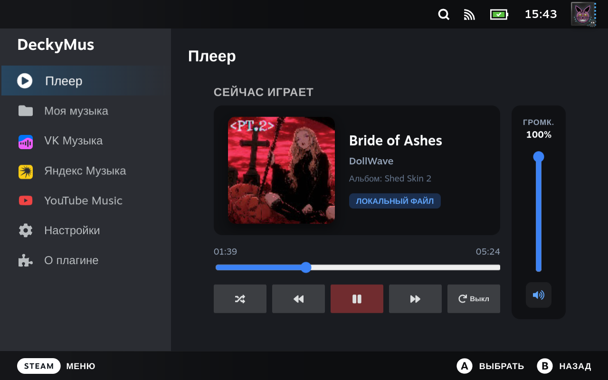

# DeckyMus 🎵

> **Музыкальный плеер с возможностью воспроизведения и скачивания музыкальных треков со стриминговых площадок специально для Decky Loader Россия**

---

## 🌟 Возможности плагина

| Плитка | Описание |
| :--- | :--- |
| 🎧 **Фоновое воспроизведение** | Музыка звучит параллельно с любыми запущенными играми в Game Mode без потери производительности. Легковесный движок потребляет < 0.1% CPU. |
| 📁 **Локальная медиатека** | Сканирование папок встроенной памяти и карт microSD (MP3, FLAC, M4A, OGG, WAV) с парсингом ID3-тегов и обложек. |
| 💜 **VK Музыка** | Интеграция музыки ВКонтакте: поиск, прослушивание и скачивание аудиозаписей *(в разработке, ожидает релиза v1.0.0)*. |
| 🟡 **Яндекс Музыка** | Стриминг треков, синхронизация плейлистов, любимых песен «Мне нравится» и общедоступного чарта Top-50. |
| 🔴 **YouTube Music** | Быстрый глобальный поиск треков, исполнителей и альбомов с сохранением истории запросов. |
| 💾 **Скачивание в память устройства** | Сохранение треков из Яндекс Музыки и YouTube Music в выбранную папку в формате MP3 с тегами и обложками для офлайн-прослушивания. |

---

## 🎮 Дополнительные особенности

* **Независимая регулировка громкости:** Ползунок громкости плеера в боковой шторке (QAM) и отдельный вертикальный регулятор во вкладке «Плеер», независимый от общей громкости SteamOS.
* **Интеграция в Quick Access Menu (шторка «...»):** Управление воспроизведением (Play/Pause, Next, Prev, Shuffle, Repeat) прямо во время игры.
* **Нативный полноэкранный интерфейс:** Полноценный медиацентр с поддержкой управления геймпадом (стики, D-Pad, бамперы L1/R1) и сенсорным экраном.
* **Мультиязычность (29 языков):** Полный перевод интерфейса на все языки Steam с автоматическим определением языка системы и возможностью ручного выбора в настройках.

---

## 🛠 Технические сведения

* **Аудиодвижок:** MPV Headless IPC (PipeWire / ALSA)
* **Интерфейс:** SteamOS Native React UI (`@decky/ui`)
* **Конвертация аудио:** FFmpeg & Mutagen ID3
* **Создано для:** **Decky Loader Россия** ([deckyloader.ru](https://deckyloader.ru/))

---

## 📦 Установка

1. Скачайте архив **`DeckyMus.zip`** из последнего [Релиза](releases).
2. Поместите архив в папку `Загрузки` (`/home/deck/Downloads`) на Steam Deck.
3. Откройте меню **Decky Loader** на консоли.
4. Перейдите в **Настройки (шестерёнка) -> Разработчик -> Установить плагин из ZIP** (или выберите пункт *Install from ZIP*).
5. Выберите скачанный файл `DeckyMus.zip` и подтвердите установку.
