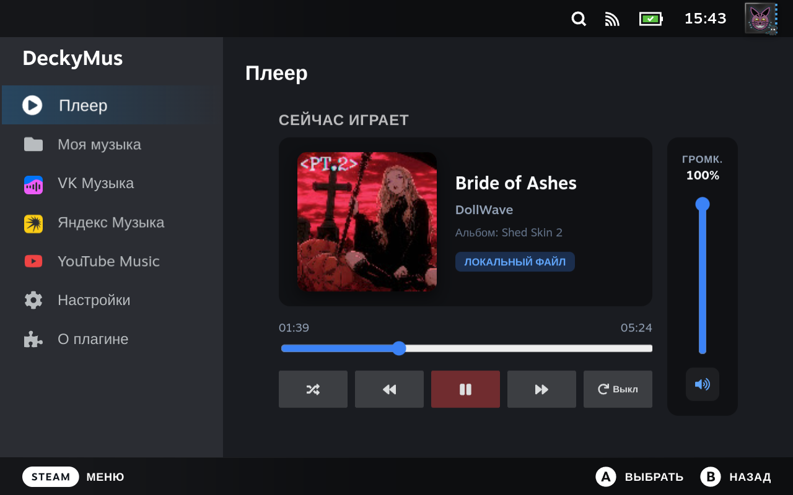

# DeckyMus 🎵

  

  <b>Musikplayer mit Streaming und Download speziell für Decky Loader Russia entwickelt</b>

  <a href="../README.md">Русский</a>
  •
  <a href="README.en.md">English</a>
  •
  <b>Deutsch</b>
  •
  <a href="README.fr.md">Français</a>
  •
  <a href="README.es.md">Español</a>
  •
  <a href="README.es-419.md">Español (LatAm)</a>
  •
  <a href="README.it.md">Italiano</a>
  •
  <a href="README.pt-BR.md">Português (Brasil)</a>
  •
  <a href="README.pt.md">Português</a>
  •
  <a href="README.pl.md">Polski</a>
  •
  <a href="README.zh-CN.md">简体中文</a>
  •
  <a href="README.zh-TW.md">繁體中文</a>
  •
  <a href="README.ja.md">日本語</a>
  •
  <a href="README.ko.md">한국어</a>
  •
  <a href="README.uk.md">Українська</a>
  •
  <a href="README.tr.md">Türkçe</a>
  •
  <a href="README.cs.md">Čeština</a>
  •
  <a href="README.da.md">Dansk</a>
  •
  <a href="README.nl.md">Nederlands</a>
  •
  <a href="README.fi.md">Suomi</a>
  •
  <a href="README.el.md">Ελληνικά</a>
  •
  <a href="README.hu.md">Magyar</a>
  •
  <a href="README.no.md">Norsk</a>
  •
  <a href="README.ro.md">Română</a>
  •
  <a href="README.sv.md">Svenska</a>
  •
  <a href="README.vi.md">Tiếng Việt</a>
  •
  <a href="README.bg.md">Български</a>
  •
  <a href="README.id.md">Bahasa Indonesia</a>
  •
  <a href="README.th.md">ไทย</a>

---

## 🌟 Funktionen des Plugins

| Feature | Description |
| :--- | :--- |
| 🎧 **Hintergrundwiedergabe** | Musik läuft parallel zu jedem Spiel im Game Mode ohne Leistungsverlust. |
| 📁 **Lokale Medienbibliothek** | Durchsucht internen Speicher und microSD (MP3, FLAC, M4A, OGG, WAV). |
| 💜 **VK Musik** | VKontakte-Integration: Suche, Streaming und Download (in Entwicklung). |
| 🟡 **Yandex Musik** | Streaming, Playlist-Synchronisation und Top-50-Charts. |
| 🔴 **YouTube Music** | Schnelle globale Suche nach Titeln, Künstlern und Alben. |
| 💾 **Auf Gerät herunterladen** | Titel aus Yandex und YouTube Music als MP3 mit Tags und Covern speichern. |

---

## 🎮 Zusätzliche Funktionen

* 🎚️ **Independent Volume Control**: Dedicated volume slider in Quick Access Menu (QAM) and a vertical slider in the "Now Playing" tab, independent from SteamOS master volume.
* ⚡ **Quick Access Menu (QAM) Integration**: Full playback control (Play/Pause, Next/Prev, Shuffle, Repeat modes) right over any running game.
* 🌐 **Multilingual (29 Languages)**: Complete support for all 29 Steam languages with automatic SteamOS language detection and manual switching in Settings.

---

## 🛠 Technische Details

* **Audio-Engine:** MPV Headless IPC (PipeWire / ALSA)
* **Benutzeroberfläche:** SteamOS Native React UI (`@decky/ui`)
* **Audio-Konvertierung:** FFmpeg & Mutagen ID3
* **Erstellt für Decky Loader Russia (deckyloader.ru)**

---

## 📦 Installation

1. Download the **`DeckyMus.zip`** archive from the latest [Release](https://github.com/Kowalski-coder/DeckyMus/releases).
2. Place the archive into your Steam Deck's `Downloads` folder (`/home/deck/Downloads`).
3. Open the **Decky Loader** menu on your Steam Deck.
4. Go to **Settings (gear icon) -> Developer -> Install plugin from ZIP** (*Install from ZIP*).
5. Select the downloaded `DeckyMus.zip` file and confirm the installation.

---

## ☕ Support the Project / Поддержка проекта

  

  👉 <b><a href="https://boosty.to/kowalski1997/donate">Поддержать автора на Boosty (Donate)</a></b> 🧡

