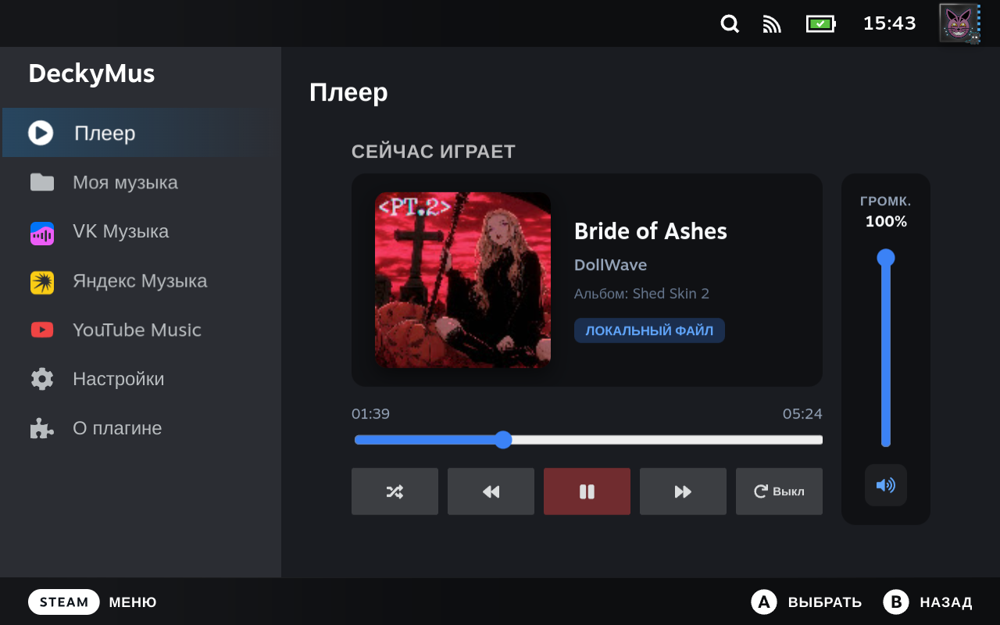

# DeckyMus 🎵

  

  <b>专为 Decky Loader Russia 打造的流媒体播放与下载音乐播放器</b>

  <a href="../README.md">Русский</a>
  •
  <a href="README.en.md">English</a>
  •
  <a href="README.de.md">Deutsch</a>
  •
  <a href="README.fr.md">Français</a>
  •
  <a href="README.es.md">Español</a>
  •
  <a href="README.es-419.md">Español (LatAm)</a>
  •
  <a href="README.it.md">Italiano</a>
  •
  <a href="README.pt-BR.md">Português (Brasil)</a>
  •
  <a href="README.pt.md">Português</a>
  •
  <a href="README.pl.md">Polski</a>
  •
  <a href="README.zh-CN.md">简体中文</a>
  •
  <b>繁體中文</b>
  •
  <a href="README.ja.md">日本語</a>
  •
  <a href="README.ko.md">한국어</a>
  •
  <a href="README.uk.md">Українська</a>
  •
  <a href="README.tr.md">Türkçe</a>
  •
  <a href="README.cs.md">Čeština</a>
  •
  <a href="README.da.md">Dansk</a>
  •
  <a href="README.nl.md">Nederlands</a>
  •
  <a href="README.fi.md">Suomi</a>
  •
  <a href="README.el.md">Ελληνικά</a>
  •
  <a href="README.hu.md">Magyar</a>
  •
  <a href="README.no.md">Norsk</a>
  •
  <a href="README.ro.md">Română</a>
  •
  <a href="README.sv.md">Svenska</a>
  •
  <a href="README.vi.md">Tiếng Việt</a>
  •
  <a href="README.bg.md">Български</a>
  •
  <a href="README.id.md">Bahasa Indonesia</a>
  •
  <a href="README.th.md">ไทย</a>

---

## 🌟 插件功能

| Feature | Description |
| :--- | :--- |
| 🎧 **后台静默播放** | 在游戏模式下与任何游戏同时运行，毫无性能损失。 |
| 📁 **本地媒体库** | 扫描机身存储与 microSD 卡 (MP3, FLAC, M4A, OGG, WAV)。 |
| 💜 **VK 音乐** | VKontakte 音乐集成: 搜索、播放在线音频与下载 (开发中)。 |
| 🟡 **Yandex 音乐** | 流媒体播放、同步收藏歌单及 Top-50 热歌榜。 |
| 🔴 **YouTube Music** | 快速全局搜索单曲、歌手及专辑，支持历史记录。 |
| 💾 **离线下载到设备** | 将在线歌曲以 MP3 格式保存到设备，内嵌封面与元数据标签。 |

---

## 🎮 額外特性

* 🎚️ **Independent Volume Control**: Dedicated volume slider in Quick Access Menu (QAM) and a vertical slider in the "Now Playing" tab, independent from SteamOS master volume.
* ⚡ **Quick Access Menu (QAM) Integration**: Full playback control (Play/Pause, Next/Prev, Shuffle, Repeat modes) right over any running game.
* 🌐 **Multilingual (29 Languages)**: Complete support for all 29 Steam languages with automatic SteamOS language detection and manual switching in Settings.

---

## 🛠 技术规格

* **音频引擎:** MPV Headless IPC (PipeWire / ALSA)
* **用户界面:** SteamOS Native React UI (`@decky/ui`)
* **音频转换:** FFmpeg & Mutagen ID3
* **专为 Decky Loader Russia (deckyloader.ru) 打造**

---

## 📦 安裝指南

1. Download the **`DeckyMus.zip`** archive from the latest [Release](https://github.com/Kowalski-coder/DeckyMus/releases).
2. Place the archive into your Steam Deck's `Downloads` folder (`/home/deck/Downloads`).
3. Open the **Decky Loader** menu on your Steam Deck.
4. Go to **Settings (gear icon) -> Developer -> Install plugin from ZIP** (*Install from ZIP*).
5. Select the downloaded `DeckyMus.zip` file and confirm the installation.

---

## ☕ Support the Project / Поддержка проекта

  

  👉 <b><a href="https://boosty.to/kowalski1997/donate">Поддержать автора на Boosty (Donate)</a></b> 🧡

